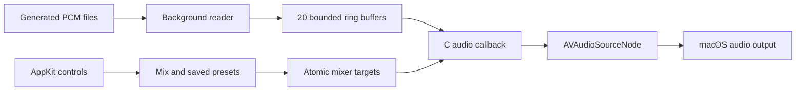

# Architecture

`QuietBar.swift` owns UI, JSON storage, animation, sleep timer and AVAudioEngine. `AudioCore.c` owns file descriptors, a reader pthread, atomic control targets and realtime mixing. There are no third-party runtime dependencies.

Each stream has 32768 stereo frames, about 5 MiB for all ring buffers. The worker fills 4096-frame chunks; the audio callback reads them without allocating, locking or doing file I/O. Acquire/release counters coordinate the single producer and consumer. Control changes use atomic targets and 100 ms smoothing; slider response is cubic.

The output stage applies master gain, mid/side stereo width, optional linked stereo compression (−12 dB threshold, 6 dB knee, 10:1 ratio, 50 ms attack, 2 s release), and a final ±0.999 ceiling. Underruns are counted. The source format is stereo 44.1 kHz; AVAudioEngine handles output routing.

## Lifecycle and data

Audio resources load before ownership transfers into `AudioPlayer`, so failures clean up once. `deinit` stops the engine and joins the worker. Load/prepare operations are initialization-only; controls can change during rendering. The C API is internal and assumes non-null handles for render/control operations.

State saves atomically, after a 400 ms debounce, to a public-edition-specific Application Support directory. Saved values are validated. Playback and sleep timer are not restored on launch. Build and test paths never use the personal prototype's state.

Quick controls and the full window share one state model. Tests invoke their handlers and inspect hidden view geometry; actual menu interaction, audible quality, VoiceOver, output-device changes and older macOS compatibility still need manual validation.
